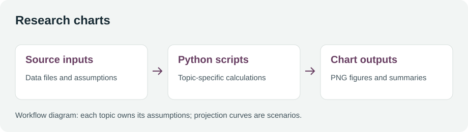
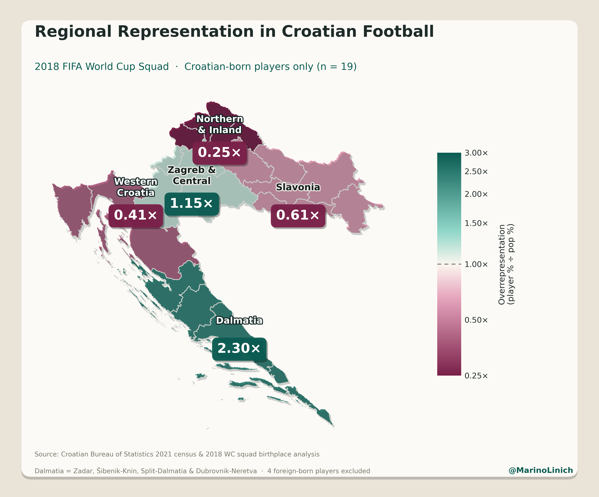
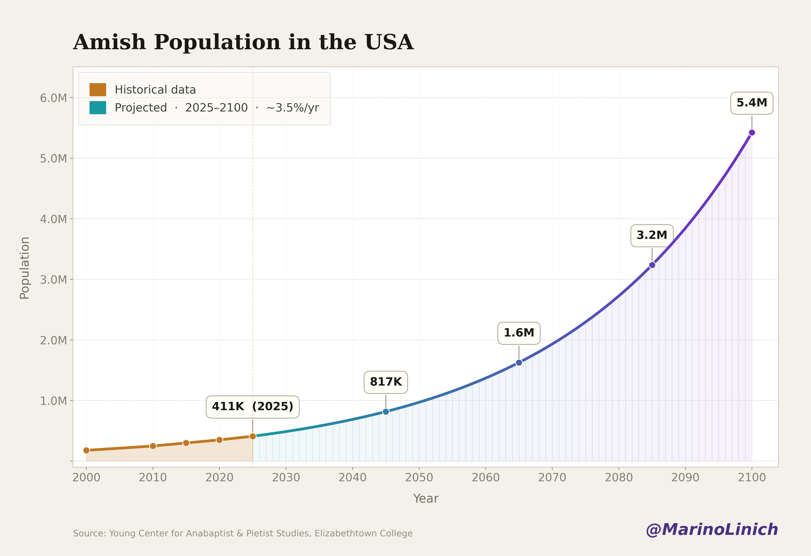

# Research charts




## Screenshots

Saved chart outputs illustrate the project; scenario curves are not observed future values.

| Croatian football output example | Amish population scenario output example |
| --- | --- |
|  |  |

Python scripts and saved figures for population, demographic and Croatian football topics. Each folder is an independent analysis with its own source inputs, parameters and output paths.

## Browse

| Folder | Contents |
| --- | --- |
| `amish/` | Population chart with historical values and scenario curves |
| `haredi/` | Population scenario chart |
| `black-on-white-homicide/` | Topic-specific homicide chart script and figures |
| `croatia-football/` | Regional football-player map and boundary data |
| [world-population](world-population/README.md) | UN WPP2024 extraction, regional aggregation and text summaries |

## Reproduce a figure

Use a local Python environment. The chart scripts use Matplotlib and NumPy; the WPP workbook pipeline uses openpyxl. Additional source files and topic-specific assumptions are described in each script or folder guide.

```powershell
py -m pip install matplotlib numpy openpyxl
cd amish
py amish-growth-2100.py
```

Run a script from its own folder when it uses relative input paths. Edit its named input/theme parameters before running. Generated figures may overwrite that script's previous output, so preserve a copy when comparing revisions.

The saved figures are examples of repository output, not newly verified statistics. Historical observations and extrapolated scenarios need separate interpretation. Recheck sources, dates and assumptions before publishing or making comparisons.
